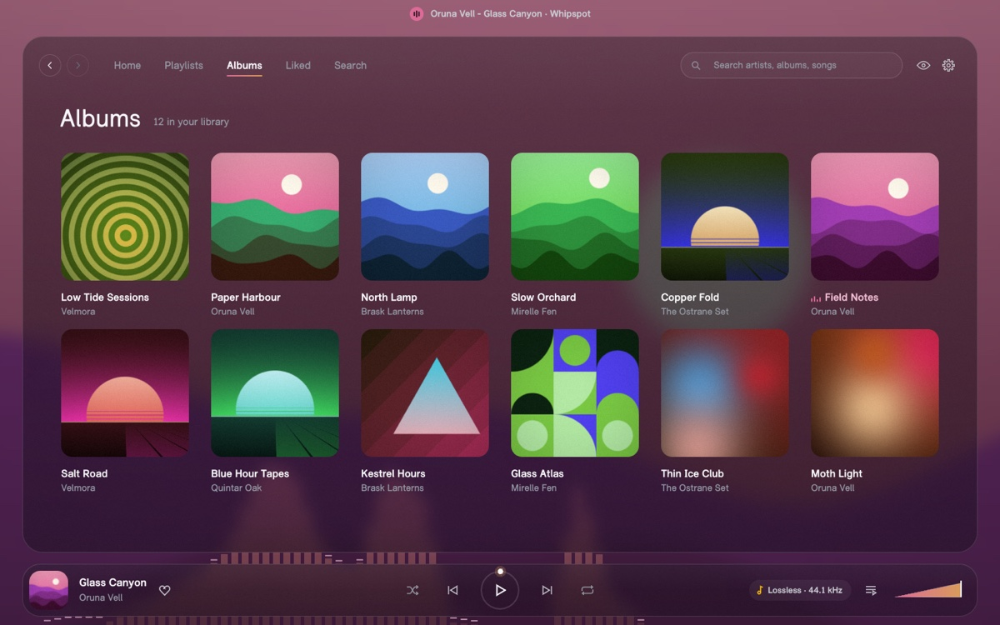
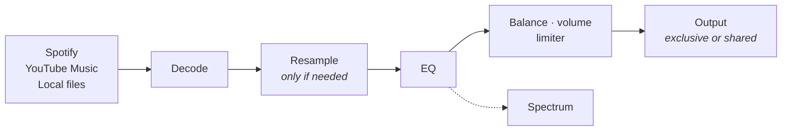

# Whipspot

A desktop music player written in Rust. Spotify, YouTube Music and your own files, in one player that cares about sound quality.



> **Early pre-release.** Built for Windows 11. The macOS build is experimental.

## What it does

| | |
|---|---|
| 🎵 **Three sources** | Spotify (Premium), YouTube Music, and local files (FLAC, ALAC, WAV, AIFF, MP3, AAC, Ogg) |
| 🎚️ **Real audio path** | Ten-band EQ, balance and a limiter, with no hidden processing |
| 💎 **Bit-perfect** | Exclusive output on Windows plays the file's own sample rate, untouched |
| 🏷️ **Honest labels** | Shows what you're really hearing: source, output and any processing |
| 📝 **Synced lyrics** | Shown full-screen when you leave the player alone |
| 🎨 **Skins** | Bring your own classic Winamp (`.wsz`) or Windows Media Player (`.wmz`) skins |
| 📱 **Spotify Connect** | Play to Whipspot from your phone |

<p>
  
  
</p>

## How the sound flows

Every source goes through the same path. Each step only runs when it's needed. With the EQ off and the volume at 100, nothing changes the music.



## Install

Get the latest installer from [**Releases**](../../releases).

- **Windows:** run `whipspot-<version>-windows-x86_64-setup.exe`. It installs for your user only. The installer isn't code-signed yet, so if SmartScreen warns you, click *More info* → *Run anyway*.
- **macOS:** open `whipspot-<version>-macos-universal.dmg` and run *Install Whipspot*. The installer isn't signed with an Apple Developer ID or notarised yet, so macOS blocks it the first time: open System Settings > Privacy & Security and choose *Open Anyway*.

> The installers are built by CI, and no installer has been run on a real Windows 11 or macOS machine yet. Treat the first install as a test.

## Updates

An installed Whipspot updates itself through [lunepack](https://github.com/lune-rs/lunepack). A minute after it starts, and every 6 hours after that, it asks `updates.izzat.dev` whether a newer version exists. If one does, **Settings → About** and the tray menu say so. Nothing is downloaded until you click **Download update**, and Whipspot restarts only when you click **Install and restart**. Every download is checked against signing keys built into the app before it is used.

- **Check now** in **Settings → About** asks straight away. Turn off **Check for updates automatically** there to stop the timed checks.
- The server keeps the 10 newest versions.
- Updating works only in a copy the installer put on your machine. A copy you built yourself, or run from a build folder, says "Updates work in installed copies".
- Nothing about updating has been run against the real update server or on a real install yet; it is built and tested on fakes only.

## Getting started

Open **Settings** (⚙️ or `Ctrl+,`) → **Accounts**.

- **Spotify:** log in for playback. To browse your library, create a free app on the [Spotify developer dashboard](https://developer.spotify.com/dashboard) with redirect URI `http://127.0.0.1:8899/callback`, then paste its Client ID into Whipspot.
- **YouTube Music:** click *Install* to get the stream helper ([yt-dlp](https://github.com/yt-dlp/yt-dlp)), then point Whipspot at a `cookies.txt` exported from your browser.
- **Local files:** nothing to set up. Your Music folder is added automatically; add more in Settings.

Your logins are kept in your system's password store, never in plain files.

## Skins

Whipspot comes with no skins. Drop your own `.wsz` or `.wmz` files into `~/.whipspot/skins` and pick one in **Settings → Skins**.

Find skins at the [Winamp Skin Museum](https://skins.webamp.org/) or the [WMP Skins Archive](https://wmpskinsarchive.neocities.org/).

Press `Ctrl+Shift+N` to go back to the normal look.

## Build from source

```
cargo run --release -p whipspot-app
```

The app icon's sources are the SVGs in `assets/icon/`; `bash scripts/make-icons.sh` (macOS; needs `rsvg-convert`, ImageMagick and `iconutil`) regenerates the `.icns`, `.ico` and `.png` files committed beside them.

Want to try it without any account? `cargo run -p whipspot-app --example demo` runs the player on made-up music.

## Good to know

- Whipspot is **unofficial** and not affiliated with Spotify, YouTube or Microsoft.
- Spotify playback uses [librespot](https://github.com/librespot-org/librespot), and YouTube Music uses your browser cookies. Both go against those services' terms, so use an account you can afford to lose.
- No skins, logos or other third-party assets are included.

## Licence

[Apache 2.0](LICENSE). Bundled fonts and vendored crates keep their own licences.
